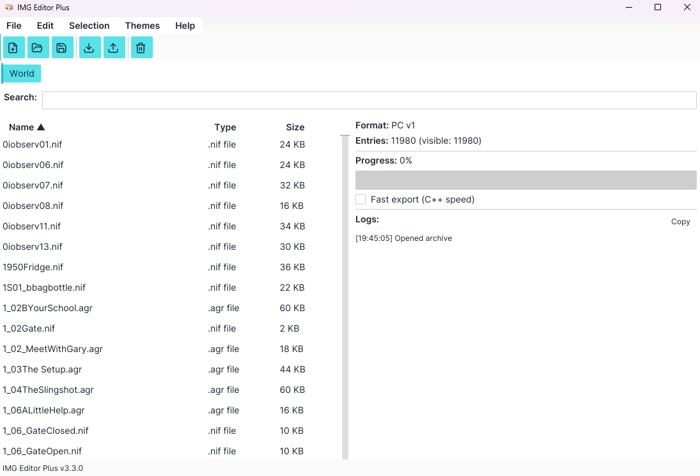
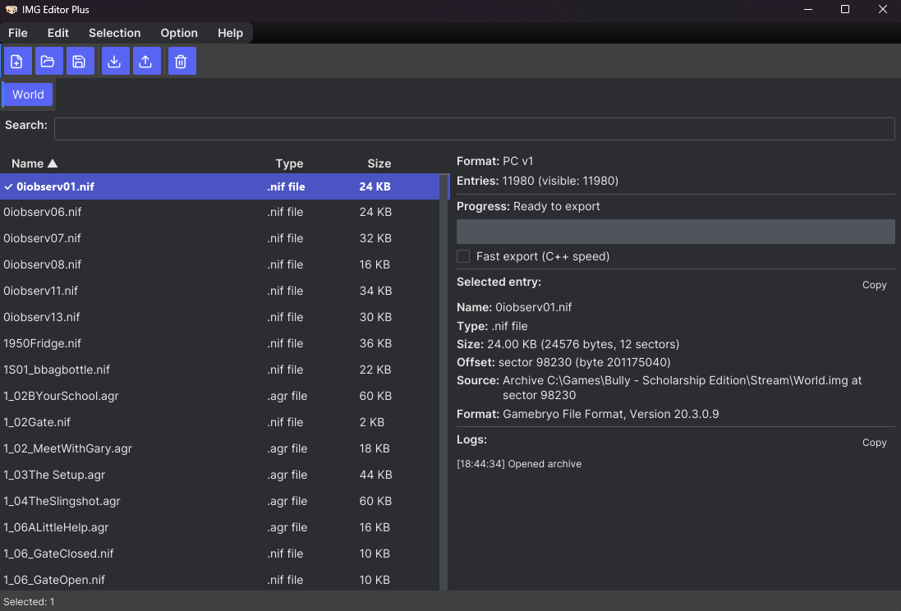
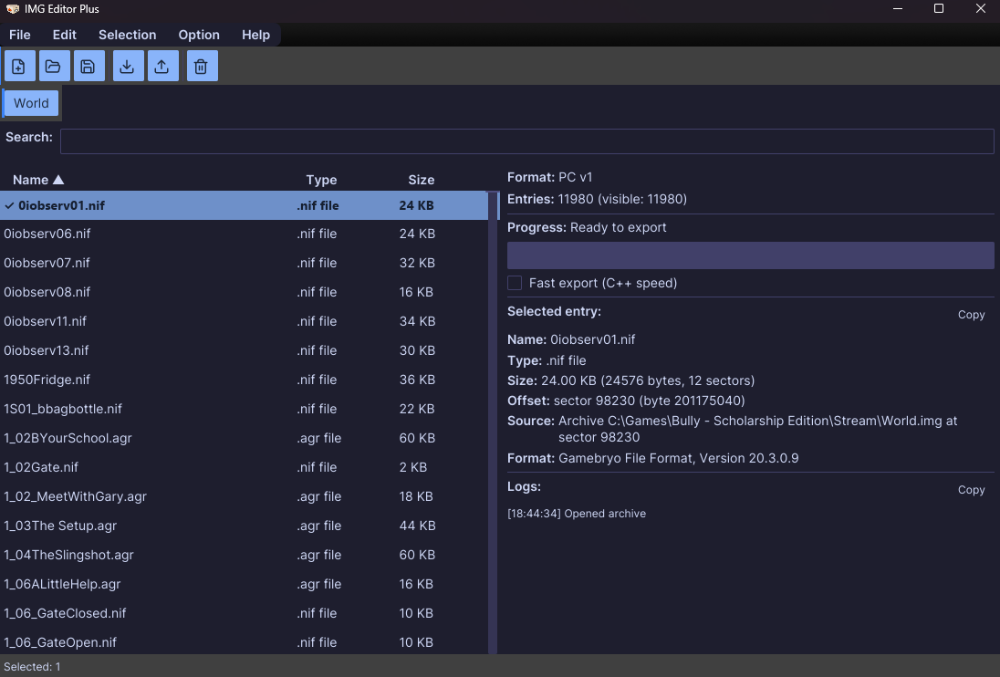
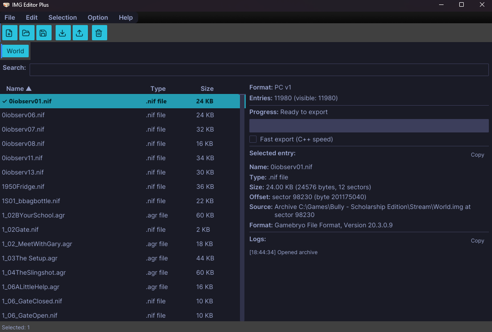
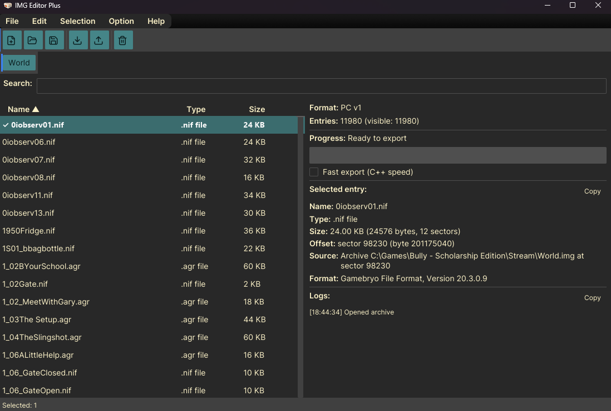
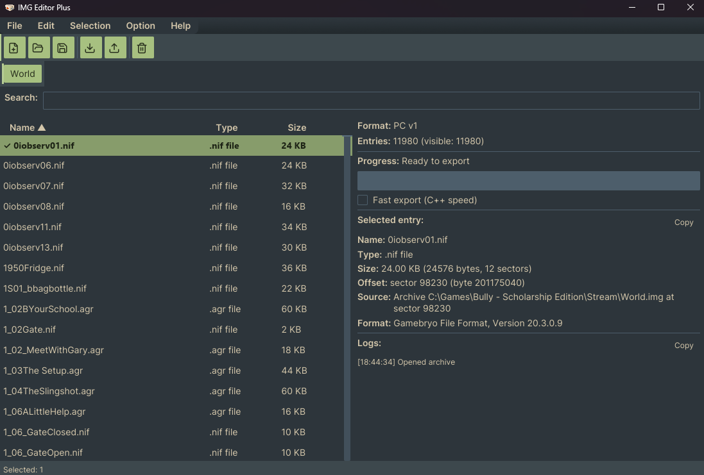

# 🎮 IMG Editor Plus v4.17.0

A **pure Rust** desktop editor for GTA and Bully IMG archives — built for **speed**, **safety**, and a modern workflow.

> Forked and evolved from [Grinch_'s IMG Editor](https://github.com/user-grinch/IMGEditor).  
> Rewritten in Rust to eliminate crashes, memory bugs, and C++ dependency hell.

> **Status:** feature-complete and in maintenance mode. Latest tagged release:
> v4.17.0.

---

## 🔥 Why Rust?

| C++ pain point | Rust replacement |
|----------------|------------------|
| 💥 **Null pointers / use-after-free** | Ownership and borrow checking at compile time |
| 🧵 **UI thread blocking on I/O** | Unified Tokio `async` runtime + `spawn_blocking` for save, export, and decoding |
| 📦 **Vendored C++ libs** (FreeType, FreeImage, GLFW, GLM, GLEW) | Pure `cargo` build — single portable executable |
| 🐛 **Memory corruption in format parsers** | `Result`-based error propagation with bounds-checked readers |
| 🐌 **Slow rebuilds and exports** | Zero-copy memory-mapped reads, Rayon parallel export/scan/decode, and two-pass sequential save |
| 🎨 **ImGui theming limits** | Iced 0.14 reactive UI with a full design-token system |

*Note: On Windows, small-file export speed is capped by an OS file-creation rate limit (~500–600 files/s, so Rust's `ZeroCopy` exporter edges out C++ modestly: 22.4 s vs 23.3 s on Bully `World.img`). Save/rebuild avoids that limit and runs ~23% faster (8.6 s → 6.6 s). See [docs/rust-vs-cpp-merits.md](docs/rust-vs-cpp-merits.md), [docs/export-optimization-lessons.md](docs/export-optimization-lessons.md), and [docs/cpp-codebase-analysis.md](docs/cpp-codebase-analysis.md).*

---

## ✨ Features

### 📁 Archive Management & I/O
- **Supported formats** — IMG v1 (GTA III, Vice City, Bully PC & Xbox 360 big-endian `.dir`/`.img`) and IMG v2 (GTA San Andreas).
- **Full editing workflow** — Create, Open, Save, Save As, Pack, multi-tab editing (middle-click to close), inline rename, single/folder/replace import, and multi-file drag-and-drop import from Explorer.
- **Fast zero-copy I/O** — memory-mapped archive reads, Rayon parallel zero-copy export with live progress and cancellation, and two-pass sequential save/rebuild.
- **Entry-list manifests** — export UTF-8 entry lists (`Ctrl+L`) and compare archives asynchronously (`Ctrl+P`) with duplicate and case-insensitive diagnostics ([docs/compare-feature.md](docs/compare-feature.md)).
- **Explorer integration** — optional per-user `.img`/`.dir` registration and per-archive game-folder overrides.

### 🛡️ Asset Compatibility Engine & Texture Converter
- **Retail-verified profiles** — validates textures against GTA III, Vice City, San Andreas, and Bully dialects, tinting entry rows by verdict with pre-flight import checks and pre-save *Fix & Save* lossless header repair.
- **Texture replacement & bulk conversion** — import PNG / DDS / BMP / TGA or bulk-convert selected TXDs to target dialects (DXT1/3/5, PAL8/PAL4 via Oklab k-means, 888/8888/565/1555/4444, full mip chains) with a true decoded-back preview and byte-preserving TXD splicing.

### 🎨 Embedded 3D Model & Animation Viewer
- **In-app `wgpu` renderer** — MSAA 4×, lit + wireframe (`W`), alpha-blended materials, Blender-style turntable orbit, interactive ±X/±Y/±Z navigation gizmo, perspective/orthographic toggle, AA grid floor, and configurable base orientation (`B`).
- **Native format previews** — PC RenderWare **DFF** models (frame/atomic transforms, material splits, TXD diffuse resolution), Bully **NIF** models with companion **NFT** textures, and **COL** v1–v4 collision meshes (including Bully `COLL`/`COL2`/`COL3`), plus external PLY/OBJ viewer export.
- **Animation player** — play, pause, scrub, and loop **Bully AGR** animations (all six PC variants, named `Anim/*.HXD` / `hxds.dat` catalogs, NIF CPU skinning — see [docs/bully-agr-research-record.md](docs/bully-agr-research-record.md)) and **GTA IFP** clips directly in the 3D viewport.

### 🖼️ Texture & Entry Inspector
- **TXD & NFT preview** — PC D3D8/D3D9 + legacy RenderWare rasters (DXT1–5, PAL4/8, 1555/565/4444/8888, plus X8R8G8B8 mismatch detection — [docs/renderware-format-mismatches.md](docs/renderware-format-mismatches.md)) and Bully NFT catalogs, with synchronized zoom/pan, UV overlays, multi-texture switching, and PNG/TGA export.
- **Entry metadata** — RenderWare chunk/version, COL version, text line counts (`.ipl`/`.ide`/`.dat`/`.scm`), and hex preview for unknown entries.

### 🔍 Search, Table & Desktop UX
- **Virtualized 10,000+ entry table** — scored fuzzy subsequence search with Jaro-Winkler typo fallback and prediction dropdown, multi-column sorting, multi-select (`Ctrl`/`Shift`/right-click), and Firefox-style middle-click autoscroll.
- **Polished native shell** — 8 themes, 6 interface languages, `View → Always on top`, hideable search bar, toggleable motion effects, window-parented native file dialogs, persistent `settings.ini`, and a GitHub update checker.

---

## 🌐 Languages

The entire interface is translated with [Project Fluent](https://projectfluent.org/) (compiled to typed functions from [`i18n/`](i18n/)) with instant switching and proper plural rules. Non-English translations are AI-translated and welcome native-speaker corrections — see [`i18n/README.md`](i18n/README.md).

| Language | Status |
|----------|--------|
| English | Source |
| Deutsch, Español, Bahasa Indonesia, Português (Brasil), Русский | AI-translated, pending native review |

---

## 🎨 Themes

Switch anytime from the **Themes** menu (Dark, Light, Catppuccin Mocha, Tokyo Night, Gruvbox, Everforest, GitHub Dark, Ayu Dark).

<details>
<summary>Click to preview themes</summary>

### Default Light


### Default Dark


### Catppuccin Mocha


### Tokyo Night


### Gruvbox Dark


### Everforest


</details>

---

## 🚀 Quick start

Requires **Rust 1.96+** and Windows.

```powershell
cargo build --release
# Or package dist\ (imgeditor.exe, README.md, LICENSE):
.\package-release.ps1
```

---

## ⌨️ Keyboard shortcuts

| Shortcut | Action |
|----------|--------|
| `Ctrl+N` / `Ctrl+O` | New / Open archive |
| `Ctrl+S` / `Ctrl+Shift+S` | Save in place / Save as |
| `Shift+X` | Close tab |
| `Ctrl+I` / `Ctrl+Shift+I` | Import / Import and replace |
| `Ctrl+E` / `Ctrl+Shift+E` | Export all / Export selected |
| `Ctrl+L` / `Ctrl+P` | Export entry list / Compare with list |
| `Ctrl+A` / `Ctrl+Shift+A` / `Ctrl+D` (`Esc`) | Select all / Invert / Deselect |
| `Delete` / `Ctrl+X` | Delete selected |
| `Ctrl+F` | Focus search box |
| `1` / `2` / `3` | Switch Export / 3D viewer / Texture tab |
| `Ctrl+U` | Check for updates |

---

## 📦 Dependencies

| Crate | Purpose |
|-------|---------|
| `iced 0.14` / `iced_aw 0.14` | Reactive GUI, menus, tabs, context menus |
| `tokio 1.54` | Unified async runtime (`rt-multi-thread`, `time`), `spawn_blocking`, and gated idle timers — [docs/rfd-tokio-runtime.md](docs/rfd-tokio-runtime.md) |
| `rfd 0.18` | Native window-parented async file/folder dialogs (`set_parent`) — [docs/rfd-tokio-runtime.md](docs/rfd-tokio-runtime.md) |
| `memmap2 0.9.12` | Zero-copy read-only archive reads (`no_probe_handle` on Windows) — [docs/memmap2-io.md](docs/memmap2-io.md) |
| `rayon 1.12` | Work-stealing parallelism for export, scan, normalize, decode, bulk conversion, palette mapping, and batch import — [docs/rayon-parallelism.md](docs/rayon-parallelism.md) |
| `rusty_alloc-api 2.6.0` | Process-wide pure-Rust mimalloc global allocator with 10 ms OS purge and teardown reclaim — [docs/allocator-rusty-alloc.md](docs/allocator-rusty-alloc.md) |
| `hashbrown 0.17.2` | SwissTable maps/sets with foldhash and zero-alloc borrowed-key lookups — [docs/hashmap-crate.md](docs/hashmap-crate.md) |
| `smallvec 1.16.6` | Union-backed inline storage for `SortChain`, `VertexSkin`, NIF skin/ref tables, and mip chains — [docs/smallvec-inline-storage.md](docs/smallvec-inline-storage.md) |
| `compact_str 0.10.0` | Inline 24-byte strings for 10,000+ archive entries, TXD texture names, and `IdeMap` — [docs/compact-str-inline-strings.md](docs/compact-str-inline-strings.md) |
| `quick_cache` | Byte-budgeted LRU caches (3D scenes, textures, inspector) with single-flight dedup |
| `glam` / `wgpu` | 3D viewer math and GPU rendering |
| `image` / `texpresso` / `quantette` | Image I/O, BC1–BC3 (DXT1/3/5) compression, and Oklab palette quantization |
| `fuzzt` | Jaro-Winkler typo fallback for search |
| `fluent-bundle` / `fluent-syntax` / `sys-locale` | Compile-time checked Project Fluent translations |
| `ureq` / `webbrowser` / `winreg` | Update checker, external links, and Windows Explorer registration |

---

## 🙏 Credits

- **Grinch_** — the original [IMG Editor](https://github.com/user-grinch/IMGEditor) that made this possible
- **MexUK & the IMGF team** — [IMG Factory](https://github.com/MexUK/IMGF), whose feature set inspired many Plus additions
- **CloudyTabzy** — Rust port, parsers, design system, 3D viewers
- **Claude, Command Code, OpenCode & Codex agents** — AI pair programming across the Rust port
- **Iced team** — the reactive GUI framework this is built on

---

## 📄 License

MIT licensed © 2025 CloudyTabzy. See [LICENSE](LICENSE). All crate dependencies use permissive licenses (MIT / Apache-2.0); bundled fonts (Inter, Bricolage Grotesque, Lucide) use SIL OFL 1.1.
